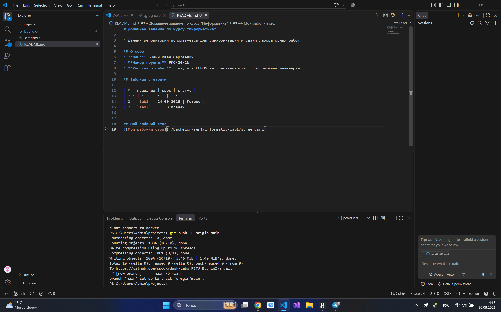

# Домашнее задание по курсу "Информатика"

> Данный репозиторий используется для синхронизации и сдачи лабораторных работ.

## О себе
* **ФИО:** Бычин Иван Сергеевич
* **Номер группы:** РИС-26-2б
* **Рассказ о себе:** Мне 18 лет, я из города Красновишерска. В школе очень мало писал на python, поэтому самостоятельно немного изучил C++. Учусь на специальности программная инженерия в ПНИПУ.

## Таблица с лабами

| № | название | срок | статус |
| :-: | :--- | :-: | :-: |
| 0 | `lab0` | — | Готово |
| 1 | `lab1` | 12.10.2026 | Готово |
| 2 | `lab2` | 25.10.2026 | Готово |
| 3 | `lab3` | 28.10.2026 | Готово |

## Интерфейс Vs code
